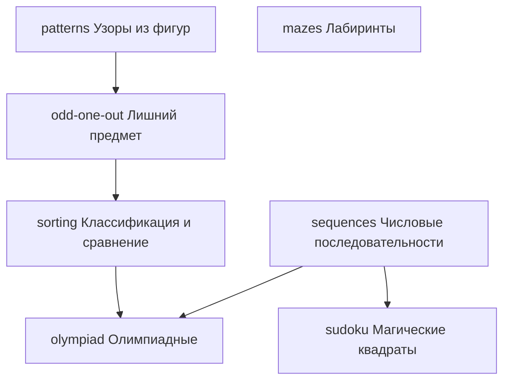

# Учебный план

**Статус:** граф математики 1–3 класса по Моро — 41 тема. **1 класс сверен по
учебнику** (страницы — у каждой темы), 2 и 3 класс — по памяти, сверить. Граф —
источник правды: что не так, правим сначала здесь, потом данные и код; тест
`curriculum-docs.test.ts` держит данные равными этому документу.

## Источники

**Порядок тем — по Моро** («Математика», М. И. Моро и др., УМК «Школа
России», «Просвещение»): спокойный темп и много закрепления — то, что нужно
этому ребёнку.

**Форматы задач — отовсюду.** Один навык, много способов спросить, чтобы
ребёнок не выучил шаблон вместо навыка:

- **Моро** — обычные упражнения, стержень;
- **Kumon** — принцип очень мелких шагов, каждый повторяется до уверенности;
- **Singapore Math** — картинки и бар-модели для текстовых задач;
- **Teaching for Mastery** (шанхайский подход в английской версии NCETM) —
  серии с вариацией, модель после ошибки и «вглубь, а не вперёд»;
- **Петерсон** и **«Кенгуру»** — нестандартные задачи: вызовы боссов и ветка
  логики.

Петерсон целиком не стержень: её темп и объём чтения стали бы стеной. Её
сильная сторона используется там, где помогает, — немного вызовов, по уже
освоенному.

**Темп и повторения — не из Моро, а наши** (mastery learning и интервальные
повторения), по скорости близко к школьному, см.
[ARCHITECTURE.md](ARCHITECTURE.md), «Прогрессия».

Как система использует этот документ: каждая тема ниже — навык целиком.
У темы — **форматы** (типы задач, плагины), у каждого формата — **разделы** по
возрастанию трудности. По умолчанию тема — один шаг, освоение считается по
всем форматам вместе; мельче тему режут, только если аналитика покажет
скопление ошибок. Тема открывается, когда освоено всё, на что она опирается.

Отметки: ✅ сделано — тема есть в данных и на стенде · ☐ ещё нет · ⚠ нужна
подготовка, указанная в строке.

---

## Граф математики

Две разные вещи, не путать:

- **рёбра** — «что нужно знать до чего»: `numbers-100 → numbers-1000` значит
  «без чисел до 100 к числам до 1000 нельзя», а не «сразу после»;
- **номер по Моро** — когда тема идёт в учебнике. Когда открыто несколько тем,
  первой идёт та, у которой номер меньше.

**Каждая тема — внутри одного класса.** Тема, которая тянется через несколько
классов, разрезается: иначе босс в 1 классе получил бы уравнения с иксом.

| № | Тема | Класс | Что | Плагин | Ответ | Статус |
|---|---|---|---|---|---|---|
| 1 | **numbers-10** | 1 | числа до 10: счёт, сравнение, соседи | `counting`, `comparing`, `neighbours` | число, выбор | ☐ |
| 2 | **length-cm-dm** | 1 | длина: длиннее, сантиметр, дециметр | `length-compare`, `ruler`, `units` | выбор, число | ☐ |
| 3 | **shapes** | 1 | фигуры | `shapes`, `shapes-count` | выбор, число | ☐ |
| 4 | **bonds-10** | 1 | состав чисел до 10 | `bonds` | число | ☐ |
| 5 | **add-sub-10** | 1 | ± в пределах 10 | `addition` | число | ✅ |
| 6 | **word-1step** | 1 | задачи в одно действие до 20 | `word`, `word-picture` | число | ☐ |
| 7 | **word-increase** | 1 | увеличить / уменьшить на | `increase-by`, `word` | число | ☐ |
| 8 | **word-difference** | 1 | на сколько больше / меньше | `difference`, `word` | число | ☐ |
| 9 | **unknown-addend** | 1 | неизвестное слагаемое | `missing` | число | ☐ |
| 10 | **mass-volume** | 1 | килограмм и литр | `scales`, `volume` | число | ☐ |
| 11 | **numbers-20** | 1 | числа 11–20 | `bonds`, `comparing`, `number-line` | число, выбор, указать | ☐ |
| 12 | **word-2step** | 1 | задачи в два действия до 20 | `word` | число | ☐ |
| 13 | **add-sub-cross-10** | 1 | ± с переходом через десяток | `addition` | число | ✅ |
| 14 | **numbers-100** | 2 | числа до 100 | `bonds`, `comparing`, `number-line` | число, выбор, указать | ☐ |
| 15 | **length-mm-m** | 2 | длина: миллиметр и метр | `units`, `units-compare` | число, выбор | ☐ |
| 16 | **money** | 2 | рубль и копейка | `money-count`, `money-make`, `units` | число, собрать | ☐ |
| 17 | **round-tens** | 2 | круглые десятки | `addition` | число | ✅ |
| 18 | **time-clock** | 2 | часы и минуты | `clock`, `units` | выбор, число | ☐ |
| 19 | **order-of-operations** | 2 | порядок действий, скобки | `chain` | число, выбор | ☐ |
| 20 | **compare-expressions** | 2 | сравнение выражений | `comparing`, `difference` | выбор, число | ☐ |
| 21 | **perimeter** | 2 | длина ломаной, периметр многоугольника | `perimeter` | число | ☐ |
| 22 | **add-sub-2digit** | 2 | двузначные без перехода | `addition` | число | ✅ |
| 23 | **add-sub-2digit-carry** | 2 | двузначные с переходом | `addition` | число | ✅ |
| 24 | **equations** | 2 | неизвестное вычитаемое и уменьшаемое, уравнения | `missing` | число | ☐ |
| 25 | **word-100** | 2 | задачи до 100 в одно и два действия | `word` | число | ☐ |
| 26 | **right-angle** | 2 | прямой угол, прямоугольник, квадрат, их периметр | `angles`, `shapes`, `perimeter` | указать, выбор, число | ☐ |
| 27 | **mult-meaning** | 2 | смысл умножения | `repeat-add`, `groups`, `array` | число, выбор | ☐ |
| 28 | **div-meaning** | 2 | смысл деления | `share`, `missing` | число | ☐ |
| 29 | **word-mult-div** | 2 | задачи на смысл × и ÷, цена-количество-стоимость | `word` | число | ☐ |
| 30 | **times-2-3** | 2 | таблица на 2 и 3 | `multiplication`, `division` | число | ☐ |
| 31 | **times-4-5** | 3 | таблица на 4 и 5 | `multiplication`, `division` | число | ☐ |
| 32 | **times-6-9** | 3 | таблица на 6–9 | `multiplication`, `division` | число | ☐ |
| 33 | **area** | 3 | площадь | `area`, `area-compare`, `units` | число, выбор | ☐ |
| 34 | **mult-div-0-1-10** | 3 | × и ÷ на 0, 1, 10 | `multiplication`, `division` | число | ☐ |
| 35 | **word-times-compare** | 3 | в n раз, во сколько раз | `word` | число | ☐ |
| 36 | **time-calendar** | 3 | сутки, месяц, год | `units`, `calendar` | число | ☐ |
| 37 | **mult-div-beyond-table** | 3 | внетабличное умножение и деление | `multiplication`, `division` | число | ☐ |
| 38 | **div-remainder** | 3 | деление с остатком | `remainder` | два числа | ☐ |
| 39 | **numbers-1000** | 3 | числа до 1000 | `bonds`, `comparing`, `roman` | число, выбор | ☐ ⚠ числительные до 1000 |
| 40 | **mass-grams** | 3 | грамм | `units` | число | ☐ |
| 41 | **add-sub-1000** | 3 | ± до 1000 | `addition`, `column` | число | ☐ ⚠ числительные до 1000 |

### Темы и разделы

> **1 класс сверен по учебнику:** М. И. Моро, С. И. Волкова, С. В. Степанова,
> «Математика. 1 класс», части 1–2, «Просвещение», 2015 — по оглавлению и
> выборочным страницам; у каждой темы 1 класса указаны страницы. **2 и 3 класс —
> по памяти, сверить.** Разделы с пометкой **П** — дополнение из Петерсон. Что не так —
> правим здесь, потом в данных и коде.

Три оси, которые не путать:

| Ось | Вопрос | Где живёт |
|---|---|---|
| **тема** | *что* учим | клетка графа |
| **формат** — тип задачи | *как* спрашиваем: голый пример, картинка, сравнение, числовая прямая | плагин; у темы может быть несколько, они выпадают вперемешку, освоение — по всем вместе |
| **разделы** — сложность | *насколько трудно*, по учебнику | у каждого формата свои, **только по возрастанию трудности**; уровни 1–5 ядро считает из них само |

Уровень k — первые ⌈k·N/5⌉ разделов формата вперемешку (N — число
разделов), уровень 5 — весь формат, как урок закрепления (см.
ARCHITECTURE.md, «Уровень внутри шага»). Монстр уровня 1 получает лёгкий
раздел **любого** формата темы, босс — весь формат. По умолчанию тема —
один шаг.

Ниже у каждого формата — плагин, форма ответа и разделы через «→», от
лёгкого к трудному. Колонка «Есть»: ✅ — формат есть в данных и на стенде, ☐ — ещё нет;
тест сверки держит ✅ равными данным.

**Отрисовки — забота плагина, не графа.** Один и тот же пример можно
показать цифрами, картинками, словами; какие отрисовки умеет плагин и где
они уместны, описано ниже, и по умолчанию ядро выдаёт их вперемешку. Граф
переопределяет это, только когда так требует методика, — например, «первые
разделы новой темы — только картинками».

| Плагин | Отрисовка | Где уместна | Есть |
|---|---|---|---|
| `addition` | цифрами `8 + 5 = ?` | везде | ✅ |
| `addition` | картинками: предметы, десятичные рамки | до 20 | ☐ |
| `addition` | словами «восемь плюс пять» | везде | ☐ |

#### 1. numbers-10 «Числа до 10» · 1 класс

Моро, 1 класс: ч. 1, с. 3–78 (подготовка и нумерация: сравнение, состав, число 0).

| Формат | Плагин, ответ | Разделы по трудности | Есть |
|---|---|---|---|
| сколько предметов? | `counting`, число | 1–5 в ряд → 1–5 вразброс → 6–10 в рамке по пять → 6–10 вразброс → 6–10 среди лишних, «только красные» (**П**) | ☐ |
| что больше? | `comparing`, выбор | далёкие числа `2 □ 9` → соседние `6 □ 7` → с равенством `5 □ 5` → число и картинка `●●●●●● □ 7` | ☐ |
| соседи числа | `neighbours`, число | следующее «после 6» → предыдущее «перед 6» → «между 4 и 6» | ☐ |

Кандидаты в форматы: числовая прямая «где 7?» (**S**, указать); расставь по порядку `3, 7, 5` (по порядку).

#### 2. length-cm-dm «Длина: сантиметр и дециметр» · 1 класс

Моро, 1 класс: ч. 1, с. 32 (длиннее, короче), с. 66 (сантиметр); ч. 2, с. 51 (дециметр).

| Формат | Плагин, ответ | Разделы по трудности | Есть |
|---|---|---|---|
| что длиннее? | `length-compare`, выбор | явно разные → близкие | ☐ |
| измерь линейкой | `ruler`, число | от нуля, целые см → не от нуля (**П**) | ☐ |
| переведи | `units`, число | `1 дм = □ см` → `1 дм 3 см = □ см` | ☐ |

#### 3. shapes «Фигуры» · 1 класс

Моро, 1 класс: ч. 1, с. 36–50 (точка, линии, отрезок, луч, ломаная, многоугольник).

| Формат | Плагин, ответ | Разделы по трудности | Есть |
|---|---|---|---|
| узнай фигуру | `shapes`, выбор | точка, отрезок, круг, треугольник → ломаная и многоугольник → повёрнутые | ☐ |
| найди все | `shapes`, выбор нескольких | 4 фигуры → 8 фигур | ☐ |
| посчитай фигуры | `shapes-count`, число | отдельные → пересекающиеся (**П**) | ☐ |

#### 4. bonds-10 «Состав чисел до 10» · 1 класс

Моро, 1 класс: ч. 1, внутри нумерации, с. 21–78 (точные страницы не сверены).

| Формат | Плагин, ответ | Разделы по трудности | Есть |
|---|---|---|---|
| домик `5 = 2 + □` | `bonds`, число | числа 2–5 → 6–9 → 10 | ☐ |
| все пары для числа (**П**) | `bonds-all`, выбор нескольких | числа до 5 → до 10 | ☐ |

#### 5. add-sub-10 «± в пределах 10» · 1 класс — ✅ сделано

Моро, 1 класс: ч. 1, с. 80 (±1), 84 (±2), 104 (±3); ч. 2, с. 8 (±4), 14 (перестановка), 29 (уменьшаемое, вычитаемое, разность).

| Формат | Плагин, ответ | Разделы по трудности | Есть |
|---|---|---|---|
| сложение | `addition`, число | `+1` → `+2` → `+3` → `+4` → `+5 … +9` перестановкой (`2 + 7`) → `+0` | ✅ |
| вычитание | `addition`, число | `−1` → `−2` → `−3` → `−4` → `6 − □ … 10 − □` через состав (`9 − 6`) → `−0` и `n − n` | ✅ |

Кандидаты в форматы: серия `5 + 1, 5 + 2, 5 + 3, 5 + □` (**TfM**); найди ошибку «Маша решила 4 + 3 = 8 — сколько на самом деле?» (**П**).

#### 6. word-1step «Задачи в одно действие» · 1 класс

Моро, 1 класс: ч. 1, с. 88 («Задача» — уже после ±2, до ±3).

| Формат | Плагин, ответ | Разделы по трудности | Есть |
|---|---|---|---|
| текстовая задача | `word`, число | сумма до 10 → остаток до 10 → обратная: «было 3, стало 8 — сколько дали?» → до 20 | ☐ |
| картинка-история, текст читает учитель | `word-picture`, число | те же разделы | ☐ |

Кандидат в форматы: бар-модель (**S**) — у Моро она уже есть в задачах в два действия.

#### 7. word-increase «Увеличить / уменьшить на» · 1 класс

Моро, 1 класс: ч. 1, с. 96 (задачи «стало на 2 больше» — внутри ±2).

| Формат | Плагин, ответ | Разделы по трудности | Есть |
|---|---|---|---|
| голое «увеличь 7 на 3» | `increase-by`, число | увеличить до 10 → уменьшить до 10 → до 20 | ☐ |
| текстовая «у Маши на 2 больше» | `word`, число | «больше на» до 10 → «меньше на» до 10 → до 20 | ☐ |

#### 8. word-difference «На сколько больше / меньше» · 1 класс

Моро, 1 класс: ч. 2, с. 10 («На сколько больше? На сколько меньше?» — после ±4, до перестановки).

| Формат | Плагин, ответ | Разделы по трудности | Есть |
|---|---|---|---|
| пары предметов на картинке | `difference-picture`, число | до 5 → до 10 | ☐ |
| голые числа «на сколько 9 больше 5?» | `difference`, число | до 10 → до 20 | ☐ |
| текстовая задача | `word`, число | до 10 → до 20 | ☐ |

#### 9. unknown-addend «Неизвестное слагаемое» · 1 класс

Моро, 1 класс: ч. 2, с. 14–29 (связь сложения и вычитания; точные страницы не сверены).

| Формат | Плагин, ответ | Разделы по трудности | Есть |
|---|---|---|---|
| `□ + 2 = 5` | `missing`, число | второе слагаемое до 10 → первое до 10 → до 20 | ☐ |

#### 10. mass-volume «Килограмм и литр» · 1 класс

Моро, 1 класс: ч. 2, с. 36 (килограмм), 38 (литр).

| Формат | Плагин, ответ | Разделы по трудности | Есть |
|---|---|---|---|
| сколько на весах? | `scales`, число | гири по 1 кг → разные гири → уравновесить (**П**) | ☐ |
| сколько литров? | `volume`, число | одинаковые банки → разные | ☐ |

#### 11. numbers-20 «Числа 11–20» · 1 класс

Моро, 1 класс: ч. 2, с. 45–59 (нумерация 46, дециметр 51).

| Формат | Плагин, ответ | Разделы по трудности | Есть |
|---|---|---|---|
| десяток и единицы | `bonds`, число | `13 = 10 + □` → `10 + 7`, `17 − 7` → `17 − 10` | ☐ |
| что больше? | `comparing`, выбор | далёкие `12 □ 19` → соседние `16 □ 17` | ☐ |
| числовая прямая (**П**) | `number-line`, указать | подписано каждое число → каждое второе → только концы | ☐ |

#### 12. word-2step «Задачи в два действия» · 1 класс

Моро, 1 класс: ч. 2, с. 62–63 (план решения, бар-модель).

| Формат | Плагин, ответ | Разделы по трудности | Есть |
|---|---|---|---|
| текстовая задача | `word`, число | сумма и остаток до 20 → «на … больше» и сумма до 20 | ☐ |
| выбери план решения (**П**) | `word-plan`, выбор | те же разделы | ☐ |

#### 13. add-sub-cross-10 «± с переходом через десяток» · 1 класс — ✅ сделано

Моро, 1 класс: ч. 2, с. 64 (табличное сложение), 80 (табличное вычитание).

| Формат | Плагин, ответ | Разделы по трудности | Есть |
|---|---|---|---|
| сложение | `addition`, число | `□ + 2` → `□ + 3` → `□ + 4` → `□ + 5` → `□ + 6` → `□ + 7` → `□ + 8` → `□ + 9` | ✅ |
| вычитание | `addition`, число | `11 − □` → `12 − □` → `13 − □` → `14 − □` → `15 − □` → `16 − □` → `17 − □` → `18 − □` | ✅ |

Кандидаты в форматы: через десяток `8 + 5 = 8 + 2 + □` (**TfM**); найди ошибку «8 + 5 = 12» (**П**).
Кандидат в правило отрисовки: первые разделы — картинками, двумя
десятичными рамками («предмет → картинка → символ»).

#### 14. numbers-100 «Числа до 100» · 2 класс

| Формат | Плагин, ответ | Разделы по трудности | Есть |
|---|---|---|---|
| десятки и единицы | `bonds`, число | `40 = □` десятков → `47 = 40 + □` → `35 − 30`, `35 − 5` | ☐ |
| что больше? | `comparing`, выбор | разные десятки `34 □ 52` → одинаковые `34 □ 37` → ловушка единиц `19 □ 21` | ☐ |
| числовая прямая (**П**) | `number-line`, указать | подписаны десятки → только концы | ☐ |

#### 15. length-mm-m «Длина: миллиметр и метр» · 2 класс

| Формат | Плагин, ответ | Разделы по трудности | Есть |
|---|---|---|---|
| переведи | `units`, число | `1 м = □ дм` → `1 м = □ см` → `1 см = □ мм` | ☐ |
| сравни величины `1 м 3 дм □ 15 дм` | `units-compare`, выбор | одна единица → две единицы | ☐ |

#### 16. money «Деньги» · 2 класс

| Формат | Плагин, ответ | Разделы по трудности | Есть |
|---|---|---|---|
| сколько денег? | `money-count`, число | монеты до 10 р → монеты и купюры до 100 р | ☐ |
| набери сумму | `money-make`, собрать | до 10 р → до 100 р | ☐ |
| сдача (**П**) | `change`, число | с 10 р → со 100 р | ☐ |
| переведи | `units`, число | `1 р = □ к` → `2 р 30 к = □ к` | ☐ |

#### 17. round-tens «Круглые десятки» · 2 класс — ✅ сделано

| Формат | Плагин, ответ | Разделы по трудности | Есть |
|---|---|---|---|
| сложение | `addition`, число | `30 + 40` | ✅ |
| вычитание | `addition`, число | `70 − 40` | ✅ |

Кандидаты в разделы: связь с однозначными `5 + 2 = 7 → 50 + 20` (**П**); три
круглых слагаемых `20 + 30 + 10` (**П**).

#### 18. time-clock «Часы и минуты» · 2 класс

| Формат | Плагин, ответ | Разделы по трудности | Есть |
|---|---|---|---|
| который час? | `clock`, выбор | целые часы → половины → четверти → по 5 минут | ☐ |
| переведи | `units`, число | `1 ч = □ мин` → `1 ч 20 мин = □ мин` | ☐ |

#### 19. order-of-operations «Порядок действий и скобки» · 2 класс

| Формат | Плагин, ответ | Разделы по трудности | Есть |
|---|---|---|---|
| вычисли | `chain`, число | три числа слева направо до 20 `7 + 2 − 5` → со скобками `20 − (5 + 3)` → до 100 → удобная группировка `27 + 15 + 3` | ☐ |
| где скобки? (**П**) | `chain-brackets`, выбор | три числа → четыре числа | ☐ |

#### 20. compare-expressions «Сравнение выражений» · 2 класс

| Формат | Плагин, ответ | Разделы по трудности | Есть |
|---|---|---|---|
| что больше? | `comparing`, выбор | число и выражение до 20 `7 □ 3 + 5` → два выражения до 20 → до 100 → «не вычисляя» `47 + 28 □ 47 + 25` (**П**) | ☐ |
| на сколько больше? | `difference`, число | до 20 → до 100 | ☐ |

#### 21. perimeter «Длина ломаной и периметр» · 2 класс

| Формат | Плагин, ответ | Разделы по трудности | Есть |
|---|---|---|---|
| по рисунку | `perimeter`, число | ломаная из 3 звеньев → треугольник → четырёхугольник по сторонам | ☐ |

#### 22. add-sub-2digit «Двузначные без перехода» · 2 класс — ✅ сделано

| Формат | Плагин, ответ | Разделы по трудности | Есть |
|---|---|---|---|
| сложение | `addition`, число | `36 + 2` → `36 + 20` → любые `45 + 23` | ✅ |
| вычитание | `addition`, число | `36 − 2` → `36 − 20` → любые `68 − 14` | ✅ |

Кандидат в форматы: запись в столбик.

#### 23. add-sub-2digit-carry «Двузначные с переходом» · 2 класс — ✅ сделано

| Формат | Плагин, ответ | Разделы по трудности | Есть |
|---|---|---|---|
| сложение | `addition`, число | до круглого `26 + 4` → через десяток `26 + 7` → любые `47 + 28` | ✅ |
| вычитание | `addition`, число | от круглого `30 − 7` → через десяток `35 − 7` → любые `63 − 27` | ✅ |

Кандидаты: в разделы — `36 + 24`, `60 − 24`; в форматы — столбик.

#### 24. equations «Уравнения» · 2 класс

| Формат | Плагин, ответ | Разделы по трудности | Есть |
|---|---|---|---|
| неизвестное вычитаемое | `missing`, число | `7 − □ = 3` до 20 → `40 − x = 25` | ☐ |
| неизвестное уменьшаемое | `missing`, число | `□ − 3 = 4` до 20 → `x − 12 = 30` | ☐ |
| неизвестное слагаемое с буквой | `missing`, число | `x + 15 = 40` | ☐ |

#### 25. word-100 «Задачи до 100» · 2 класс

| Формат | Плагин, ответ | Разделы по трудности | Есть |
|---|---|---|---|
| текстовая задача | `word`, число | в одно действие → «на … больше / меньше» → в два действия | ☐ |
| картинка-история, текст читает учитель | `word-picture`, число | те же разделы | ☐ |

#### 26. right-angle «Прямой угол, прямоугольник, квадрат» · 2 класс

| Формат | Плагин, ответ | Разделы по трудности | Есть |
|---|---|---|---|
| где прямой угол? | `angles`, указать | один угол → среди острых и тупых | ☐ |
| это прямоугольник? квадрат? | `shapes`, выбор | явные → повёрнутые и похожие | ☐ |
| периметр прямоугольника и квадрата | `perimeter`, число | прямоугольник по двум сторонам → квадрат по одной стороне | ☐ |

#### 27. mult-meaning «Смысл умножения» · 2 класс

| Формат | Плагин, ответ | Разделы по трудности | Есть |
|---|---|---|---|
| сумма одинаковых `3 + 3 + 3 = □` | `repeat-add`, число | 2–3 слагаемых по 2–5 → 4–5 слагаемых → слагаемые до 9 | ☐ |
| сумма → произведение `3 + 3 + 3 = 3 × □` | `repeat-add`, число | те же разделы | ☐ |
| группы на картинке «4 тарелки по 3» | `groups`, число | маленькие группы → большие | ☐ |
| массив «3 ряда по 5» | `array`, число | до 3 рядов → до 5 рядов | ☐ |
| `3 × 4` и `4 × 3` — одно и то же? | `commutative`, выбор | маленькие числа → большие | ☐ |

Кандидат в форматы: солдатики перед камерой — «3 ряда по 4» (далёкое будущее).

#### 28. div-meaning «Смысл деления» · 2 класс

| Формат | Плагин, ответ | Разделы по трудности | Есть |
|---|---|---|---|
| поровну по картинке «12 конфет троим» | `share`, число | до 10 → до 20 | ☐ |
| по содержанию «12 конфет по 3 — сколько детей?» | `share`, число | до 10 → до 20 | ☐ |
| неизвестный множитель `3 × □ = 12` | `missing`, число | на 2 → на 3 | ☐ |

#### 29. word-mult-div «Задачи на × и ÷» · 2 класс

| Формат | Плагин, ответ | Разделы по трудности | Есть |
|---|---|---|---|
| смысл умножения и деления | `word`, число | «по 3 в 4 тарелках» → «12 поровну на 3» | ☐ |
| цена, количество, стоимость | `word`, число | найти стоимость → найти цену или количество | ☐ |

#### 30. times-2-3 «Таблица на 2 и 3» · 2 класс

| Формат | Плагин, ответ | Разделы по трудности | Есть |
|---|---|---|---|
| умножение | `multiplication`, число | `× 2` → `× 3` | ☐ |
| деление | `division`, число | `: 2` → `: 3` | ☐ |
| серия «прыжками» `2, 4, 6, □` (**TfM**) | `skip-count`, число | по 2 → по 3 | ☐ |

#### 31. times-4-5 «Таблица на 4 и 5» · 3 класс

| Формат | Плагин, ответ | Разделы по трудности | Есть |
|---|---|---|---|
| умножение | `multiplication`, число | `× 4` → `× 5` | ☐ |
| деление | `division`, число | `: 4` → `: 5` | ☐ |

#### 32. times-6-9 «Таблица на 6–9» · 3 класс

| Формат | Плагин, ответ | Разделы по трудности | Есть |
|---|---|---|---|
| умножение | `multiplication`, число | `× 6` → `× 7` → `× 8` → `× 9` | ☐ |
| деление | `division`, число | `: 6` → `: 7` → `: 8` → `: 9` | ☐ |

#### 33. area «Площадь» · 3 класс

| Формат | Плагин, ответ | Разделы по трудности | Есть |
|---|---|---|---|
| какая фигура больше? | `area-compare`, выбор | явно разные → близкие | ☐ |
| площадь в клетках | `area`, число | прямоугольник → сложная фигура | ☐ |
| площадь прямоугольника | `area`, число | стороны 2–3 → стороны 2–5 | ☐ |
| переведи | `units`, число | `1 дм² = □ см²` → `1 м² = □ дм²` | ☐ |

#### 34. mult-div-0-1-10 «× и ÷ на 0, 1, 10» · 3 класс

| Формат | Плагин, ответ | Разделы по трудности | Есть |
|---|---|---|---|
| умножение | `multiplication`, число | `× 1` → `× 0` → `× 10` | ☐ |
| деление | `division`, число | `: 1` → `a : a` → `0 : a` → `: 10` | ☐ |

#### 35. word-times-compare «В n раз, во сколько раз» · 3 класс

| Формат | Плагин, ответ | Разделы по трудности | Есть |
|---|---|---|---|
| голое «увеличь 6 в 3 раза» | `times-by`, число | увеличить → уменьшить | ☐ |
| текстовая | `word`, число | «в n раз больше / меньше» → «во сколько раз больше?» | ☐ |

#### 36. time-calendar «Сутки, месяц, год» · 3 класс

| Формат | Плагин, ответ | Разделы по трудности | Есть |
|---|---|---|---|
| переведи | `units`, число | `1 сут = □ ч` → `1 год = □ мес` | ☐ |
| календарь | `calendar`, число | дни недели → дни в месяце | ☐ |

#### 37. mult-div-beyond-table «Внетабличное умножение и деление» · 3 класс

| Формат | Плагин, ответ | Разделы по трудности | Есть |
|---|---|---|---|
| умножение | `multiplication`, число | круглые `20 × 3` → двузначное `23 × 4` | ☐ |
| деление | `division`, число | круглые `60 : 3` → `80 : 20` → деление суммы `78 : 2` → подбором `87 : 29` | ☐ |

#### 38. div-remainder «Деление с остатком» · 3 класс

| Формат | Плагин, ответ | Разделы по трудности | Есть |
|---|---|---|---|
| по картинке «17 конфет по 5» | `remainder-picture`, два числа | до 20 | ☐ |
| пример `17 : 5` | `remainder`, два числа | до 20 → до 50 → до 100 | ☐ |

#### 39. numbers-1000 «Числа до 1000» · 3 класс ⚠ числительные до 1000

| Формат | Плагин, ответ | Разделы по трудности | Есть |
|---|---|---|---|
| разряды | `bonds`, число | `300 = □` сотен → `347 = 300 + 40 + □` | ☐ |
| что больше? | `comparing`, выбор | разные сотни → одинаковые сотни | ☐ |
| `× 10`, `× 100` | `multiplication`, число | `× 10` → `× 100` → `: 10` | ☐ |
| римские цифры | `roman`, число | до 10 → до 20 → до 40 | ☐ |

#### 40. mass-grams «Грамм» · 3 класс

| Формат | Плагин, ответ | Разделы по трудности | Есть |
|---|---|---|---|
| переведи | `units`, число | `1 кг = □ г` → `2 кг 300 г = □ г` | ☐ |

#### 41. add-sub-1000 «± до 1000» · 3 класс ⚠ числительные до 1000

| Формат | Плагин, ответ | Разделы по трудности | Есть |
|---|---|---|---|
| сложение | `addition`, число | `300 + 200` → `450 + 30` → `470 + 80` → `260 + 310` → любые | ☐ |
| вычитание | `addition`, число | `500 − 200` → `480 − 30` → `560 − 90` → `670 − 140` → любые | ☐ |
| в столбик | `column`, число | без перехода → с переходом | ☐ |

### Какие новые плагины делать первыми

По порядку Моро — ближайшие несделанные темы 1 класса и плагины, которые они
открывают:

1. **numbers-10** — `counting`, `comparing`, `neighbours`;
2. **length-cm-dm**, **shapes** — `length-compare`, `ruler`, `units`, `shapes`;
3. **bonds-10** — `bonds`;
4. **word-1step**, **word-increase**, **word-difference** — `word`, `increase-by`, `difference`.

Плагин, нужный многим темам, окупается сразу: `comparing` закрывает формат в
numbers-10, numbers-20, numbers-100, compare-expressions и numbers-1000.

---

## Ветка логики

Своя лестница и свои пороги — память, внимание и логика — цели игры, а не
десерт. От арифметики ей нужен только счёт до десяти, поэтому она идёт
параллельно и ничего не блокирует.

| Тема | Что | Пример | Ответ | Статус |
|---|---|---|---|---|
| **sequences** | числовые последовательности | `2, 4, 6, □` → `5, 10, 15, □` → `1, 2, 4, 7, □` | число | ☐ |
| **patterns** | узоры из фигур | ● ▲ ● ▲ ● ? — выбери следующую | выбор | ☐ |
| **odd-one-out** | лишний предмет | четыре картинки, одна не подходит | выбор | ☐ |
| **sorting** | классификация и сравнение | «кто выше», «что тяжелее» из двух фактов | выбор | ☐ |
| **mazes** | лабиринты | «какой выход ведёт к сокровищу — 1, 2 или 3?» | выбор | ☐ |
| **sudoku** | магические квадраты, судоку 4×4 | одна пустая клетка | число | ☐ |
| **olympiad** | олимпиадные | одна хитрость, одно число | число | ☐ |

Короткие логические задачи могут жить в бою как «заклинание» — больше времени
подумать, больше урона. Длинные (лабиринты) получают свой режим.

### Темы и разделы

> Тема → форматы → разделы только по трудности, как в арифметике. Источник —
> Петерсон (**П**) и «Кенгуру» (**К**), у Моро логика идёт рубриками
> «на смекалку». По памяти, сверить.

#### sequences «Числовые последовательности»

| Формат | Плагин, ответ | Разделы по трудности | Есть |
|---|---|---|---|
| продолжи ряд `2, 4, 6, □` | `sequence`, число | шаг 1 вверх и вниз → шаг 2 → шаг 5 и 10 → растущий шаг `1, 2, 4, 7` (**П**) | ☐ |
| пропуск в середине `2, 4, □, 8` | `sequence`, число | шаг 1 → шаг 2 → шаг 5 и 10 | ☐ |

#### patterns «Узоры из фигур»

| Формат | Плагин, ответ | Разделы по трудности | Есть |
|---|---|---|---|
| что дальше? ● ▲ ● ▲ ? | `pattern`, выбор | чередование двух → повтор из трёх → два признака: форма и цвет | ☐ |
| что пропущено? ● ▲ ? ▲ ● (**П**) | `pattern`, выбор | чередование двух → повтор из трёх | ☐ |

#### odd-one-out «Лишний предмет»

| Формат | Плагин, ответ | Разделы по трудности | Есть |
|---|---|---|---|
| найди лишнюю картинку | `odd-one-out`, выбор | по форме → по цвету или размеру → по смыслу: яблоко, груша, слива, морковь | ☐ |
| найди лишнее число (**П**) | `odd-one-out`, выбор | чётность → кратность | ☐ |

#### sorting «Классификация и сравнение»

| Формат | Плагин, ответ | Разделы по трудности | Есть |
|---|---|---|---|
| кто выше? по фактам | `facts`, выбор | два предмета → три предмета (**П**) | ☐ |
| разложи по группам | `sort`, по группам | по одному признаку → по двум (**П**) | ☐ |

#### mazes «Лабиринты»

| Формат | Плагин, ответ | Разделы по трудности | Есть |
|---|---|---|---|
| какой выход ведёт к сокровищу? | `maze`, выбор | маленький, 3 выхода → большой, 4 выхода → с ключом по пути (**П**) | ☐ |

#### sudoku «Судоку и магические квадраты»

| Формат | Плагин, ответ | Разделы по трудности | Есть |
|---|---|---|---|
| судоку 4×4 | `sudoku`, число | одна пустая клетка → две клетки подряд → три клетки | ☐ |
| магический квадрат 3×3 (**П**) | `magic-square`, число | одна пустая клетка → две | ☐ |

#### olympiad «Олимпиадные» (**К**) — вызовы боссов

| Формат | Плагин, ответ | Разделы по трудности | Есть |
|---|---|---|---|
| посчитай фигуры | `shapes-count`, число | отдельные → пересекающиеся | ☐ |
| задачи на возраст | `word`, число | один шаг → два шага | ☐ |
| взвешивания | `scales`, число | замена одной гири → цепочка замен | ☐ |

У patterns … mazes ответ только выбором. По правилу «у каждого шага есть формат с ответом
числом» им нужен формат-партнёр (например, patterns: «какая фигура будет десятой —
сколько кругов до неё?») или для логики правило нужно ослабить — открытый
вопрос.

---

## Память и внимание

Режим «тренировка мага», где моторика и память сами по себе цель — и где
зарабатываются щиты и свитки подсказок. Отдельный документ, позже.

---

## Сверить с учебниками

- 2 и 3 класс Моро — по оглавлению и страницам, как 1 класс;
- в 1 классе — точные страницы bonds-10 и unknown-addend (помечены «не сверены»);
- форматы задач в учебниках, которых здесь нет, — кандидаты в плагины.
