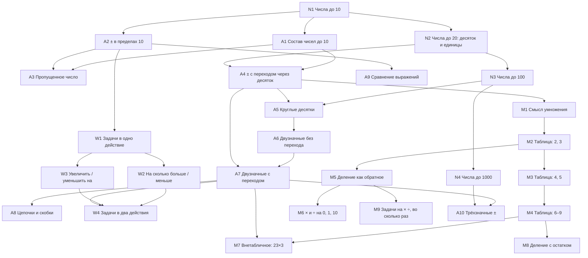
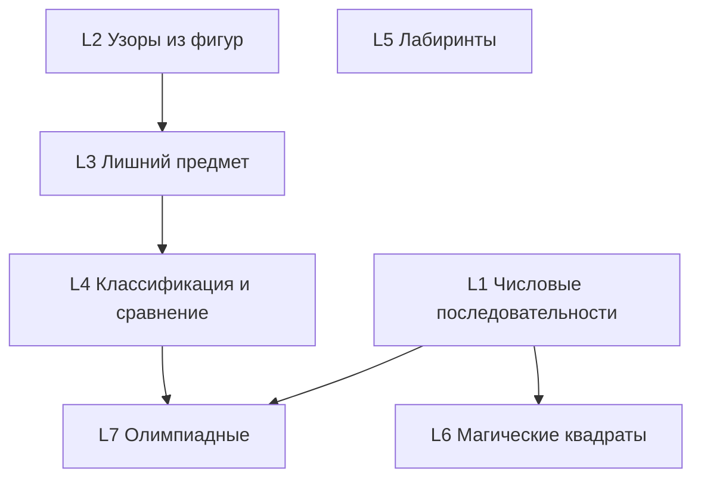

# Учебный план

**Статус: черновик на ревью, 2026-10-18.** Первый проход по стандартной
программе начальной школы, 1–3 класс. Нужно сверить с учебниками, которые есть
дома, и поправить. Главное здесь — рёбра графа (что на чём стоит).

## Источники

**Порядок тем — по Моро** («Математика», М. И. Моро и др., УМК «Школа
России», «Просвещение»): спокойный темп и много закрепления — то, что нужно
этому ребёнку.

**Форматы задач — отовсюду.** Один навык, много способов спросить, чтобы
ребёнок не выучил шаблон вместо навыка:

- **Моро** — обычные упражнения, стержень;
- **Kumon** — принцип очень мелких шагов, каждый повторяется до уверенности;
- **Singapore Math** — картинки и бар-модели для текстовых задач;
- **Teaching for Mastery** (шанхайский подход в английской версии NCETM) —
  серии с вариацией, модель после ошибки и «вглубь, а не вперёд»;
- **Петерсон** и **«Кенгуру»** — нестандартные задачи: вызовы боссов и ветка
  логики.

Петерсон целиком не стержень: её темп и объём чтения стали бы стеной. Её
сильная сторона используется там, где помогает, — немного вызовов, по уже
освоенному.

**Темп и повторения — не из Моро, а наши** (mastery learning и интервальные
повторения), по скорости близко к школьному, см.
[ARCHITECTURE.md](ARCHITECTURE.md), «Прогрессия».

Как система использует этот документ: каждая строка ниже — **тема** (навык
целиком). Внутри темы — **шаги**: маленькие куски, которые осваиваются за раз,
технически — список форматов (плагин задачи плюс положение его регуляторов),
освоение считается по всем форматам вместе. У неразрезанной
темы один шаг. Тема открывается, только когда освоено всё, на что она
опирается. На более мелкие шаги тема режется там, где аналитика показывает
скопление ошибок.

Отметки: ✅ есть в старой игре (перенести как плагин) · ⏸ написано там, но не
играется · ☐ новое · ⚠ заблокировано тем, что указано в строке.

---

## Ветка арифметики

| Тема | Что | Плагин и регуляторы | Ответ | Статус |
|---|---|---|---|---|
| **N1** | числа до 10: счёт, сравнение | `comparing` range 10 | выбор | ✅ (comparing L1, до 20) |
| **A1** | состав чисел до 10: `5 = 2 + □` | `bonds` целое 2–5, 6–10 | число | ✅ making-a-number L1–2 |
| **A2** | ± в пределах 10 | `addition`/`subtraction` range 5, 10, без перехода | число | ✅ L1–2 |
| **A3** | пропущенное число `□+2=5` | `missing` в пределах 5, в пределах 10 | число | ✅ L2–3 |
| **N2** | числа до 20: `13 = 10 + 3` | `bonds` разряды второго десятка | число | ✅ making-a-number L3 |
| **A4** | ± с переходом через десяток, до 20 | `addition` crossesTen, firstAddend 9 → 8 → any | число | ✅ половина L3. **Первый кандидат на мелкие шаги** |
| **N3** | числа до 100: десятки и единицы, сравнение | `bonds` десятки+единицы; `comparing` двузначные | число, выбор | ✅ making L4, comparing L2 |
| **A5** | круглые десятки `30+40` | `addition` roundTens | число | ✅ половина L3 |
| **A6** | двузначные без перехода | `addition` twoDigit, carry never | число | ✅ L4 |
| **A7** | двузначные с переходом | `addition` twoDigit, carry always | число | ✅ L5 |
| **A8** | цепочки ±, скобки | `chain` count 3–4, brackets | число | ⏸ |
| **A9** | сравнение выражений | `comparing` суммы | выбор | ✅ comparing L3–5 |
| **W1** | задачи в одно действие | `word` в пределах 5, 10, потом 20, 100 | число | ✅ только L1–2 |
| **W2** | «на сколько больше / меньше» | `word-difference`, плюс голое `9 и 5` | число | ☐ |
| **W3** | «увеличь / уменьши на» | `increase-by` | число | ☐ |
| **W4** | задачи в два действия | `word` steps 2 | число | ☐ |
| **M1** | умножение как сложение одинаковых: `3+3+3+3 = □ × 3` | `repeat-add`, с картинками групп | число | ☐ |
| **M2–M4** | таблица: на 2, 3 → 4, 5 → 6–9 | `multiplication` набор множителей | число | ☐ |
| **M5** | деление как обратное | `division` из освоенных множителей | число | ☐ |
| **M6** | × и ÷ на 0, 1, 10 | `multiplication` special | число | ☐ |
| **M7** | внетабличное `23×3`, `84÷4` | `multiplication` двузначное×однозначное | число | ☐ |
| **M8** | деление с остатком | `division` remainder | **два числа** | ☐ |
| **M9** | задачи на × ÷, «во сколько раз» | `word` ops × ÷ | число | ☐ |
| **N4** | числа до 1000 | `bonds`, `comparing` трёхзначные | число | ⚠ числительные кончаются на 100 |
| **A10** | трёхзначные ± | `addition` threeDigit | число | ⚠ числительные кончаются на 100 |

### Каталог форматов

Кандидаты на форматы для каждой темы — меню, из которого выбирать:
вычёркивайте лишнее, дописывайте своё (например, задание со страницы
учебника). Плагины делаются по порядку тем; каждый новый формат проходит
«Просмотр задач» на `/admin`, прежде чем попасть к ребёнку.

Источник: **М** — Моро · **S** — Singapore Math · **П** — Петерсон /
«Кенгуру» · **TfM** — Teaching for Mastery. ✅ — уже есть в старой игре.
Форма ответа — в скобках.

| Тема | Форматы-кандидаты |
|---|---|
| **N1** | ✅ сравнение «больше / меньше / равно» (М, выбор) · сколько предметов на картинке (S, число) · «нажми, где на числовой прямой 7» (S, указать) · расставь по порядку `3, 7, 5` (М, по порядку) |
| **A1** | ✅ домик `5 = 2 + □` (М, число) · десятичная рамка: сколько точек не хватает до 10 (S/TfM, число) · отметь все пары, дающие 10 (П, выбор нескольких) |
| **A2** | ✅ голый пример `3 + 2` (М, число) · картинка «3 яблока и ещё 2» (S, число) · серия `5+1, 5+2, 5+3, 5+□` (TfM, число) · найди ошибку «Маша решила 4 + 3 = 8» (П, число) |
| **A3** | ✅ `□ + 2 = 5` (М, число) · весы: сколько гирек доложить, чтобы уравновесить (П, число) · бар-модель с неизвестной частью (S, число) |
| **N2** | ✅ `13 = 10 + □` (М, число) · собери число из палочек: «+десяток», «+единица» (S, собрать) · «нажми, где на прямой 13» (S, указать) |
| **A4** | ✅ голый `8 + 5` (М, число) · через десяток `8 + 5 = 8 + 2 + □` (TfM, число) · две десятичные рамки как модель (S, число) · найди ошибку «8 + 5 = 12» (П, число) |
| **N3** | ✅ `47 = 40 + □` (М, число) · ✅ сравнение двузначных (М, выбор) · собери 47 из десятков и единиц (S, собрать) · расставь по порядку `19, 21, 12` (М, по порядку) · числовая прямая до 100 (S, указать) |
| **A5** | ✅ голый `30 + 40` (М, число) · пучки палочек по десять (S, число) · серия-связка `3 + 4 → 30 + 40` (TfM, число) |
| **A6** | ✅ голый `45 + 23` (М, число) · запись в столбик, ответ числом (М, число) · таблица разрядов «десятки / единицы» (S, число) |
| **A7** | ✅ голый `47 + 28` (М, число) · в столбик (М, число) · найди ошибку: забыт перенос, `47 + 28 = 65` (П, число) · через круглое `47 + 28 = 47 + 30 − □` (П, число — скорее вызов) |
| **A8** | ⏸ цепочка `7 + 2 − 5` (М, число) · «где нужны скобки, чтобы вышло 17» (П, выбор) · история в несколько действий (М, число) |
| **A9** | ✅ сравнение сумм (М, выбор) · «не считая: что больше, 47 + 28 или 47 + 25?» (П, выбор — вызов) |
| **W1** | ✅ текстовая задача (М, число) · бар-модель (S, число) · **картинка-история, текст читает учитель** (S, число) — для ребёнка с трудностями чтения это может оказаться главным форматом |
| **W2** | голое «на сколько 9 больше 5?» (М, число) · текстовая (М, число) · бар-модель сравнения (S, число) |
| **W3** | «увеличь 7 на 3» (М, число) · текстовая (М, число) · числовая прямая «шагни на 3 вперёд» (S, указать) |
| **W4** | текстовая в два действия (М, число) · бар-модель из двух частей (S, число) · выбери план «сначала +, потом −» (П, выбор) |
| **M1** | группы «3 тарелки по 4 яблока» (S, число) · сложение одинаковых `4 + 4 + 4 = □ × 4` (М, число) · массив точек рядами (S/TfM, число) · *потом:* солдатики перед камерой |
| **M2–M4** | голый `3 × 4` (М, число) · массив (S, число) · серия «прыжками» `2, 4, 6, □` (TfM, число) · «3 × 4 и 4 × 3 — одно и то же?» (TfM, выбор) |
| **M5** | голый `12 ÷ 3` (М, число) · «раздай 12 конфет поровну троим» (S, число) · обратное `3 × □ = 12` (М, число) |
| **M6** | голый `7 × 0`, `7 × 1`, `7 × 10` (М, число) · «что будет, если умножить на 0?» (М, выбор) |
| **M7** | голый `23 × 3` (М, число) · разложение `23 × 3 = 20 × 3 + 3 × 3` (TfM, число) · в столбик (М, число) |
| **M8** | `17 ÷ 5` (М, два числа) · «раздай 17 конфет по 5 — сколько детей и сколько останется?» (S, два числа) |
| **M9** | текстовая (М, число) · бар-модель «во сколько раз» (S, число) |

Логика (L1–L7) — форматы уже в примерах таблицы её ветки ниже.

**Величины, время, деньги и геометрия** — тоже темы 1–3 класса: длина (см,
дм, м), часы, монеты, фигуры и периметр. С ответом-выбором (картинки на
кнопках) и процедурным SVG большинство из них перестают быть недоступными:
«какие часы показывают половину четвёртого — 1, 2 или 3?», «сколько денег на
столе?», «периметр этого прямоугольника». Они войдут отдельными темами, когда
учебники покажут, где им место.

Примерно по классам у Моро: **1 класс** — N1, A1–A4, N2, W1–W3; **2 класс** —
N3, A5–A9, W4, M1, M2, M5; **3 класс** — M3, M4, M6–M9, N4, A10. Ребёнок на A7
— примерно 2 класс.

### Что дальше, исходя из того, где ребёнок сейчас

Ребёнок уже работает с переходом (A7). Сначала самое дешёвое — везде ответ
числом и никакой новой механики:

1. **W2** «на сколько больше» и **W3** «увеличь на» — новый смысл, знакомая
   арифметика.
2. **A8** цепочки — уже написаны в старой игре.
3. **M1 → M2** — начало умножения; укладывается в пределы 100.

---

## Ветка логики

Своя лестница и свои пороги — память, внимание и логика — цели игры, а не
десерт. От арифметики ей нужен только счёт до десяти, поэтому она идёт
параллельно и ничего не блокирует.

| Тема | Что | Пример | Ответ | Статус |
|---|---|---|---|---|
| **L1** | числовые последовательности | `2, 4, 6, □` → `5, 10, 15, □` → `1, 2, 4, 7, □` | число | ☐ |
| **L2** | узоры из фигур | ● ▲ ● ▲ ● ? — выбери следующую | выбор | ☐ |
| **L3** | лишний предмет | четыре картинки, одна не подходит | выбор | ☐ |
| **L4** | классификация и сравнение | «кто выше», «что тяжелее» из двух фактов | выбор | ☐ |
| **L5** | лабиринты | «какой выход ведёт к сокровищу — 1, 2 или 3?» | выбор | ☐ |
| **L6** | магические квадраты, судоку 4×4 | одна пустая клетка | число | ☐ |
| **L7** | олимпиадные | одна хитрость, одно число | число | ☐ |

Короткие логические задачи могут жить в бою как «заклинание» — больше времени
подумать, больше урона. Длинные (лабиринты) получают свой режим.

---

## Память и внимание

Режим «тренировка мага», где моторика и память сами по себе цель — и где
зарабатываются щиты и свитки подсказок. Отдельный документ, позже.

---

## Сверить с учебниками

- порядок N4/A10 относительно M1–M4 (2 и 3 класс у Моро и Петерсон
  различаются);
- где стоят величины, время, деньги и геометрия;
- какие форматы задач есть в учебниках, но отсутствуют здесь, — они станут
  плагинами.
