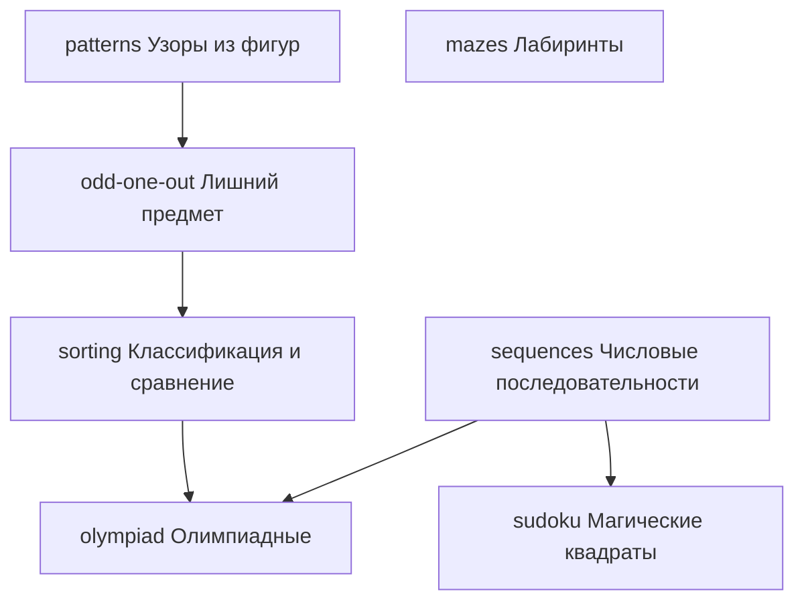

# Учебный план

**Статус:** граф математики 1–3 класса по Моро — 41 тема. **1 класс сверен по
учебнику** (страницы — у каждой темы), 2 и 3 класс — по памяти, сверить. Граф —
источник правды: что не так, правим сначала здесь, потом данные и код; тест
`curriculum-docs.test.ts` держит данные равными этому документу.

## Источники

**Порядок тем — по Моро** («Математика», М. И. Моро и др., УМК «Школа
России», «Просвещение»): спокойный темп и много закрепления — то, что нужно
этому ребёнку.

**Форматы задач — отовсюду.** Один навык, много способов спросить, чтобы
ребёнок не выучил шаблон вместо навыка:

- **Моро** — обычные упражнения, стержень;
- **Kumon** — принцип очень мелких шагов, каждый повторяется до уверенности;
- **Singapore Math** — картинки и бар-модели для текстовых задач;
- **Teaching for Mastery** (шанхайский подход в английской версии NCETM) —
  серии с вариацией, модель после ошибки и «вглубь, а не вперёд»;
- **Петерсон** и **«Кенгуру»** — нестандартные задачи: ★ и ★★ у боссов и ветка
  логики.

Петерсон целиком не стержень: её темп и объём чтения стали бы стеной. Её
сильная сторона используется там, где помогает, — задачи со звёздочкой, по уже
освоенному.

**Темп и повторения — не из Моро, а наши** (mastery learning и интервальные
повторения), по скорости близко к школьному, см.
[ARCHITECTURE.md](ARCHITECTURE.md), «Прогрессия».

Как система использует этот документ: каждая тема ниже — навык целиком.
У темы — **форматы** (типы задач, плагины), у каждого формата — **разделы** по
возрастанию трудности. По умолчанию тема — один шаг, освоение считается по
всем форматам вместе; мельче тему режут, только если аналитика покажет
скопление ошибок. Тема открывается, когда освоено всё, на что она опирается.

Отметки: ✅ сделано — тема есть в данных и на стенде · ☐ ещё нет · ⚠ нужна
подготовка, указанная в строке.

---

## Граф математики

Две разные вещи, не путать:

- **рёбра** — «что нужно знать до чего»: `numbers-100 → numbers-1000` значит
  «без чисел до 100 к числам до 1000 нельзя», а не «сразу после»;
- **номер по Моро** — когда тема идёт в учебнике. Когда открыто несколько тем,
  первой идёт та, у которой номер меньше.

**Каждая тема — внутри одного класса.** Тема, которая тянется через несколько
классов, разрезается: иначе босс в 1 классе получил бы уравнения с иксом.

```mermaid
graph TD
  subgraph g1 [1 класс]
    numbers_10[1 numbers-10 Числа до 10]
    length_cm[2 length-cm Длина: сантиметр]
    shapes[3 shapes Фигуры]
    bonds_10[4 bonds-10 Состав чисел до 10]
    add_sub_10[5 add-sub-10 ± в пределах 10]
    word_1step[6 word-1step Задачи в одно действие]
    word_increase[7 word-increase Увеличить / уменьшить на]
    word_difference[8 word-difference На сколько больше / меньше]
    unknown_addend[9 unknown-addend Неизвестное слагаемое]
    mass_volume[10 mass-volume Килограмм и литр]
    numbers_20[11 numbers-20 Числа 11–20]
    word_2step[12 word-2step Задачи в два действия]
    add_sub_cross_10[13 add-sub-cross-10 ± с переходом через десяток]
  end
  subgraph g2 [2 класс]
    numbers_100[14 numbers-100 Числа до 100]
    length_mm_m[15 length-mm-m Длина: мм и м]
    money[16 money Деньги]
    round_tens[17 round-tens Круглые десятки]
    time_clock[18 time-clock Часы и минуты]
    order_of_operations[19 order-of-operations Порядок действий и скобки]
    compare_expressions[20 compare-expressions Сравнение выражений]
    perimeter[21 perimeter Периметр]
    add_sub_2digit[22 add-sub-2digit Двузначные без перехода]
    add_sub_2digit_carry[23 add-sub-2digit-carry Двузначные с переходом]
    equations[24 equations Уравнения]
    word_100[25 word-100 Задачи до 100]
    right_angle[26 right-angle Прямой угол, прямоугольник]
    mult_meaning[27 mult-meaning Смысл умножения]
    div_meaning[28 div-meaning Смысл деления]
    word_mult_div[29 word-mult-div Задачи на × и ÷]
    times_2_3[30 times-2-3 Таблица на 2 и 3]
  end
  subgraph g3 [3 класс]
    times_4_5[31 times-4-5 Таблица на 4 и 5]
    times_6_9[32 times-6-9 Таблица на 6–9]
    area[33 area Площадь]
    mult_div_0_1_10[34 mult-div-0-1-10 × и ÷ на 0, 1, 10]
    word_times_compare[35 word-times-compare В n раз, во сколько раз]
    time_calendar[36 time-calendar Сутки, месяц, год]
    mult_div_beyond_table[37 mult-div-beyond-table Внетабличное]
    div_remainder[38 div-remainder Деление с остатком]
    numbers_1000[39 numbers-1000 Числа до 1000]
    mass_grams[40 mass-grams Грамм]
    add_sub_1000[41 add-sub-1000 ± до 1000]
  end

  %% 1 класс
  numbers_10 --> bonds_10 --> add_sub_10
  numbers_10 --> length_cm
  numbers_10 --> shapes
  add_sub_10 --> word_1step
  add_sub_10 --> word_increase
  add_sub_10 --> word_difference
  add_sub_10 --> unknown_addend
  add_sub_10 --> mass_volume
  add_sub_10 --> numbers_20
  word_1step --> word_2step
  numbers_20 --> word_2step
  numbers_20 --> add_sub_cross_10
  bonds_10 --> add_sub_cross_10

  %% 2 класс
  numbers_20 --> numbers_100
  length_cm --> length_mm_m
  numbers_100 --> length_mm_m
  numbers_100 --> money
  numbers_100 --> round_tens
  add_sub_cross_10 --> round_tens
  numbers_100 --> time_clock
  add_sub_cross_10 --> order_of_operations
  add_sub_cross_10 --> compare_expressions
  length_mm_m --> perimeter
  shapes --> perimeter
  round_tens --> add_sub_2digit --> add_sub_2digit_carry
  unknown_addend --> equations
  add_sub_2digit_carry --> equations
  word_2step --> word_100
  add_sub_2digit_carry --> word_100
  shapes --> right_angle
  perimeter --> right_angle
  right_angle --> area
  add_sub_cross_10 --> mult_meaning
  mult_meaning --> div_meaning
  div_meaning --> word_mult_div
  mult_meaning --> times_2_3
  div_meaning --> times_2_3

  %% 3 класс
  times_2_3 --> times_4_5 --> times_6_9
  times_4_5 --> area
  times_6_9 --> mult_div_0_1_10
  word_mult_div --> word_times_compare
  times_6_9 --> word_times_compare
  time_clock --> time_calendar
  times_6_9 --> mult_div_beyond_table
  add_sub_2digit_carry --> mult_div_beyond_table
  times_6_9 --> div_remainder
  numbers_100 --> numbers_1000
  mult_div_0_1_10 --> numbers_1000
  numbers_1000 --> mass_grams
  mass_volume --> mass_grams
  numbers_1000 --> add_sub_1000
  add_sub_2digit_carry --> add_sub_1000
```

| № | Тема | Класс | Что | Плагин | Ответ | Статус |
|---|---|---|---|---|---|---|
| 1 | **numbers-10** | 1 | числа до 10: счёт, сравнение, соседи | `counting`, `comparing`, `neighbours` | число, выбор | ✅ |
| 2 | **length-cm** | 1 | длина: длиннее, короче, сантиметр | `length-compare`, `ruler` | выбор, число | ✅ |
| 3 | **shapes** | 1 | фигуры | `shapes` | выбор, число | ✅ |
| 4 | **bonds-10** | 1 | состав чисел до 10 | `bonds` | число | ✅ |
| 5 | **add-sub-10** | 1 | ± в пределах 10 | `addition` | число | ✅ |
| 6 | **word-1step** | 1 | задачи в одно действие | `word`, `word-picture` | число | ✅ |
| 7 | **word-increase** | 1 | увеличить / уменьшить на | `word` | число | ✅ |
| 8 | **word-difference** | 1 | на сколько больше / меньше | `difference`, `word` | число | ✅ |
| 9 | **unknown-addend** | 1 | неизвестное слагаемое | `missing` | число | ✅ |
| 10 | **mass-volume** | 1 | килограмм и литр | `measure` | число | ✅ |
| 11 | **numbers-20** | 1 | числа 11–20 | `bonds`, `comparing`, `number-line`, `units`, `ruler` | число, выбор | ✅ |
| 12 | **word-2step** | 1 | задачи в два действия | `word` | число, выбор | ✅ |
| 13 | **add-sub-cross-10** | 1 | ± с переходом через десяток | `addition` | число | ✅ |
| 14 | **numbers-100** | 2 | числа до 100 | `bonds`, `comparing`, `number-line` | число, выбор | ✅ |
| 15 | **length-mm-m** | 2 | длина: миллиметр и метр | `units` | число, выбор | ✅ |
| 16 | **money** | 2 | рубль и копейка | `money`, `units` | число | ✅ |
| 17 | **round-tens** | 2 | круглые десятки | `addition` | число | ✅ |
| 18 | **time-clock** | 2 | часы и минуты | `clock`, `units` | выбор, число | ✅ |
| 19 | **order-of-operations** | 2 | порядок действий, скобки | `chain` | число, выбор | ✅ |
| 20 | **compare-expressions** | 2 | сравнение выражений | `expressions`, `difference` | выбор, число | ✅ |
| 21 | **perimeter** | 2 | длина ломаной, периметр многоугольника | `perimeter` | число | ✅ |
| 22 | **add-sub-2digit** | 2 | двузначные без перехода | `addition` | число | ✅ |
| 23 | **add-sub-2digit-carry** | 2 | двузначные с переходом | `addition` | число | ✅ |
| 24 | **equations** | 2 | неизвестное вычитаемое и уменьшаемое, уравнения | `missing` | число | ✅ |
| 25 | **word-100** | 2 | задачи до 100 в одно и два действия | `word` | число | ✅ |
| 26 | **right-angle** | 2 | прямой угол, прямоугольник, квадрат, их периметр | `angles`, `shapes`, `perimeter` | выбор, число | ✅ |
| 27 | **mult-meaning** | 2 | смысл умножения | `groups` | число, выбор | ✅ |
| 28 | **div-meaning** | 2 | смысл деления | `groups`, `missing` | число | ✅ |
| 29 | **word-mult-div** | 2 | задачи на смысл × и ÷, цена-количество-стоимость | `word` | число | ✅ |
| 30 | **times-2-3** | 2 | таблица на 2 и 3 | `times` | число | ✅ |
| 31 | **times-4-5** | 3 | таблица на 4 и 5 | `times` | число | ✅ |
| 32 | **times-6-9** | 3 | таблица на 6–9 | `times` | число | ✅ |
| 33 | **area** | 3 | площадь | `area`, `units` | выбор, число | ✅ |
| 34 | **mult-div-0-1-10** | 3 | × и ÷ на 0, 1, 10 | `times` | число | ✅ |
| 35 | **word-times-compare** | 3 | в n раз, во сколько раз | `word` | число | ✅ |
| 36 | **time-calendar** | 3 | сутки, месяц, год | `units`, `calendar` | число, выбор | ✅ |
| 37 | **mult-div-beyond-table** | 3 | внетабличное умножение и деление | `times` | число | ✅ |
| 38 | **div-remainder** | 3 | деление с остатком | `remainder` | число | ✅ |
| 39 | **numbers-1000** | 3 | числа до 1000 | `bonds`, `comparing`, `times`, `roman` | число, выбор | ✅ ⚠ числительные до 1000 |
| 40 | **mass-grams** | 3 | грамм | `units` | число | ✅ |
| 41 | **add-sub-1000** | 3 | ± до 1000 | `addition`, `column` | число | ✅ ⚠ числительные до 1000 |

### Темы и разделы

> **1 класс сверен по учебнику:** М. И. Моро, С. И. Волкова, С. В. Степанова,
> «Математика. 1 класс», части 1–2, «Просвещение», 2015 — по оглавлению и
> выборочным страницам; у каждой темы 1 класса указаны страницы. **2 и 3 класс —
> по памяти, сверить.** Разделы с пометкой **П** — дополнение из Петерсон. Что не так —
> правим здесь, потом в данных и коде.

Три оси, которые не путать:

| Ось | Вопрос | Где живёт |
|---|---|---|
| **тема** | *что* учим | клетка графа |
| **формат** — тип задачи | *как* спрашиваем: голый пример, картинка, сравнение, числовая прямая | плагин; у темы может быть несколько, они выпадают вперемешку, освоение — по всем вместе |
| **разделы** — сложность | *насколько трудно*, по учебнику | у каждого формата свои, **только по возрастанию трудности**; уровни 1–5 ядро считает из них само |

Уровни ядро считает само: разделы формата делятся на **пять полос по
порядку**, и монстр уровня k даёт только свою полосу — слабый только лёгкое,
сильный только трудное (см. ARCHITECTURE.md, «Уровень внутри шага»). **Босс**
даёт трудное (последний раздел обычного формата), а также задачи из
форматов **★** и **★★** — они в таблице темы отдельными строками и обычным
монстрам не выпадают. По умолчанию тема — один шаг.

Ниже у каждого формата — плагин, форма ответа и разделы через «→», от
лёгкого к трудному. Колонка «Есть»: ✅ — формат есть в данных и на стенде, ☐ — ещё нет;
тест сверки держит ✅ равными данным.

**Отрисовки — забота плагина, не графа.** Один и тот же пример можно
показать цифрами, картинками, словами; какие отрисовки умеет плагин и где
они уместны, описано ниже, и по умолчанию ядро выдаёт их вперемешку. Граф
переопределяет это, только когда так требует методика, — например, «первые
разделы новой темы — только картинками».

| Плагин | Отрисовка | Где уместна | Есть |
|---|---|---|---|
| `addition` | цифрами `8 + 5 = ?` | везде | ✅ |
| `addition` | картинками: фишки в десятичных рамках, вычитание — зачёркнутые | до 20 | ✅ |
| `addition` | словами «восемь плюс пять» | до 1000 | ✅ |
| `counting` | кружки: в ряд, в рамке по пять, вразброс | до 10 | ✅ |
| `comparing` | цифрами `6 □ 7` | везде | ✅ |
| `comparing` | картинкой слева: кружки против числа | до 10 | ✅ |
| `neighbours` | числа в ряд с пустой клеткой `4, □, 6` | везде | ✅ |
| `length-compare` | две полоски, красная над синей | везде | ✅ |
| `ruler` | полоска над линейкой с делениями через полсантиметра | везде | ✅ |
| `units` | записью, как в учебнике `1 дм 3 см = □ см` | везде | ✅ |
| `shapes` | фигура на поле; поле из разных фигур | везде | ✅ |
| `bonds` | домик: число на крыше, части внизу | до 10 | ✅ |
| `bonds` | строкой `13 = 10 + □` | везде | ✅ |
| `missing` | строкой `□ + 2 = 5` | везде | ✅ |
| `difference` | два ряда кружков парами | до 10 | ✅ |
| `difference` | словами «на сколько 9 больше, чем 5?» | везде | ✅ |
| `measure` | весы с гирями; банки с литрами | до 10 | ✅ |
| `number-line` | прямая с делениями и стрелкой | до 20 шагов | ✅ |
| `word` | текстом, и он же читается вслух | везде | ✅ |
| `word` | картинкой-историей: ряды фишек, добавленные зелёные, убранные зачёркнуты | до 20 | ✅ |

#### 1. numbers-10 «Числа до 10» · 1 класс — ✅ сделано

Моро, 1 класс: ч. 1, с. 3–78 (подготовка и нумерация: сравнение, состав, число 0).

| Формат | Плагин, ответ | Разделы по трудности | Есть |
|---|---|---|---|
| сколько предметов? | `counting`, число | 1–5 в ряд → 1–5 вразброс → 6–10 в рамке по пять → 6–10 вразброс → 6–10 среди лишних, «только красные» (**П**) | ✅ |
| что больше? | `comparing`, выбор | далёкие числа `2 □ 9` → соседние `6 □ 7` → с равенством `5 □ 5` → число и картинка `●●●●●● □ 7` | ✅ |
| соседи числа | `neighbours`, число | следующее «после 6» → предыдущее «перед 6» → «между 4 и 6» | ✅ |
| ★ сравни две группы | `comparing`, выбор | `●●● ●● □ 6` — сложить группы в уме и сравнить с числом | ✅ |
| ★ через одно | `neighbours`, число | «какое число через одно после 4?» → «через одно перед 9?» | ✅ |
| ★★ очередь | `word`, число | очередь до 10 (**П**) | ✅ |

Кандидаты в форматы: числовая прямая «где 7?» (**S**, указать); расставь по порядку `3, 7, 5` (по порядку).

#### 2. length-cm «Длина: сантиметр» · 1 класс — ✅ сделано

Моро, 1 класс: ч. 1, с. 32 (длиннее, короче), с. 66 (сантиметр). Дециметр
(ч. 2, с. 51) у Моро идёт внутри чисел 11–20 и перенесён в numbers-20:
`1 дм 3 см = 13 см` без чисел до 20 не решить.

| Формат | Плагин, ответ | Разделы по трудности | Есть |
|---|---|---|---|
| что длиннее? | `length-compare`, выбор | явно разные → почти равные → «какая короче?» → не от одного края (**П**) → бывают одинаковые (**П**) | ✅ |
| измерь линейкой | `ruler`, число | от нуля, до 10 см → не от нуля, до 10 см (**П**) | ✅ |

#### 3. shapes «Фигуры» · 1 класс — ✅ сделано

Моро, 1 класс: ч. 1, с. 36–50 (точка, линии, отрезок, луч, ломаная, многоугольник).

| Формат | Плагин, ответ | Разделы по трудности | Есть |
|---|---|---|---|
| узнай фигуру | `shapes`, выбор | круг, треугольник, квадрат, прямоугольник → точка, прямая, луч, отрезок, кривая → ломаная и многоугольники → повёрнутые, неровные (**П**) | ✅ |
| посчитай фигуры | `shapes`, число | треугольники среди 4–6 фигур → квадраты среди 7–10 → четырёхугольники, квадраты тоже, повёрнутые (**П**) | ✅ |
| найди все | `shapes`, выбор нескольких | 4 фигуры → 8 фигур | ✅ |

Ответ «выбор нескольких»: фигуры пронумерованы, ребёнок нажимает номера всех нужных и «Готово».

#### 4. bonds-10 «Состав чисел до 10» · 1 класс — ✅ сделано

Моро, 1 класс: ч. 1, внутри нумерации, с. 21–78 (точные страницы не сверены).

| Формат | Плагин, ответ | Разделы по трудности | Есть |
|---|---|---|---|
| домик 5 = 2 + □ | `bonds`, число | числа 2–5 → 6–9 → 10 | ✅ |
| все пары для числа | `bonds`, выбор нескольких | числа до 5 (**П**) → до 10 (**П**) | ✅ |

#### 5. add-sub-10 «± в пределах 10» · 1 класс — ✅ сделано

Моро, 1 класс: ч. 1, с. 80 (±1), 84 (±2), 104 (±3); ч. 2, с. 8 (±4), 14 (перестановка), 29 (уменьшаемое, вычитаемое, разность).

| Формат | Плагин, ответ | Разделы по трудности | Есть |
|---|---|---|---|
| сложение | `addition`, число | `+1` → `+2` → `+3` → `+4` → `+5 … +9` перестановкой (`2 + 7`) → `+0` | ✅ |
| вычитание | `addition`, число | `−1` → `−2` → `−3` → `−4` → `6 − □ … 10 − □` через состав (`9 − 6`) → `−0` и `n − n` | ✅ |

Кандидаты в форматы: серия `5 + 1, 5 + 2, 5 + 3, 5 + □` (**TfM**); найди ошибку «Маша решила 4 + 3 = 8 — сколько на самом деле?» (**П**).

#### 6. word-1step «Задачи в одно действие» · 1 класс — ✅ сделано

Моро, 1 класс: ч. 1, с. 88 («Задача» — уже после ±2, до ±3).

| Формат | Плагин, ответ | Разделы по трудности | Есть |
|---|---|---|---|
| текстовая задача | `word`, число | сумма до 10 → остаток до 10 → обратная: «было 3, стало 8 — сколько подарили?» | ✅ |
| картинка-история, текст читает учитель | `word`, число | сумма до 10 → остаток до 10 → обратная: сколько подарили? | ✅ |

Задачи до 20 — в word-2step и дальше: числа 11–20 у Моро идут позже этой темы.

Кандидат в форматы: бар-модель (**S**) — у Моро она уже есть в задачах в два действия.

#### 7. word-increase «Увеличить / уменьшить на» · 1 класс — ✅ сделано

Моро, 1 класс: ч. 1, с. 96 (задачи «стало на 2 больше» — внутри ±2).

| Формат | Плагин, ответ | Разделы по трудности | Есть |
|---|---|---|---|
| голое «увеличь 7 на 3» | `word`, число | увеличить до 10 → уменьшить до 10 | ✅ |
| текстовая «у Маши на 2 больше» | `word`, число | «больше на» до 10 → «меньше на» до 10 | ✅ |

#### 8. word-difference «На сколько больше / меньше» · 1 класс — ✅ сделано

Моро, 1 класс: ч. 2, с. 10 («На сколько больше? На сколько меньше?» — после ±4, до перестановки).

| Формат | Плагин, ответ | Разделы по трудности | Есть |
|---|---|---|---|
| пары предметов на картинке | `difference`, число | до 5 → до 10 | ✅ |
| голые числа «на сколько 9 больше 5?» | `difference`, число | до 10 | ✅ |
| текстовая задача | `word`, число | до 10 | ✅ |

#### 9. unknown-addend «Неизвестное слагаемое» · 1 класс — ✅ сделано

Моро, 1 класс: ч. 2, с. 14–29 (связь сложения и вычитания; точные страницы не сверены).

| Формат | Плагин, ответ | Разделы по трудности | Есть |
|---|---|---|---|
| □ + 2 = 5 | `missing`, число | второе слагаемое `3 + □ = 5` → первое `□ + 2 = 5` → вычитаемое `7 − □ = 3` | ✅ |

#### 10. mass-volume «Килограмм и литр» · 1 класс — ✅ сделано

Моро, 1 класс: ч. 2, с. 36 (килограмм), 38 (литр).

| Формат | Плагин, ответ | Разделы по трудности | Есть |
|---|---|---|---|
| сколько на весах? | `measure`, число | гири по 1 кг → разные гири 1, 2, 5 кг → уравновесить: гиря и на чаше с предметом (**П**) | ✅ |
| сколько литров? | `measure`, число | одинаковые банки по 1 л → разные 1, 2, 3 л | ✅ |

#### 11. numbers-20 «Числа 11–20» · 1 класс — ✅ сделано

Моро, 1 класс: ч. 2, с. 45–59 (нумерация 46, дециметр 51).

| Формат | Плагин, ответ | Разделы по трудности | Есть |
|---|---|---|---|
| десяток и единицы | `bonds`, число | `13 = 10 + □` → `10 + 7` → `17 − 7` → `17 − 10` | ✅ |
| что больше? | `comparing`, выбор | далёкие `12 □ 19` → соседние `16 □ 17` | ✅ |
| числовая прямая | `number-line`, число | (**П**) подписано каждое число → каждое второе → только концы | ✅ |
| переведи | `units`, число | `2 дм = □ см`, `20 см = □ дм` → `1 дм 3 см = □ см` → `13 см = 1 дм □ см` | ✅ |
| измерь линейкой | `ruler`, число | до 20 см, от нуля → не от нуля (**П**) | ✅ |

Числовая прямая отвечается числом: «какое число отмечено стрелкой?» — вида ответа «указать» в ядре пока нет.

#### 12. word-2step «Задачи в два действия» · 1 класс — ✅ сделано

Моро, 1 класс: ч. 2, с. 62–63 (план решения, бар-модель).

| Формат | Плагин, ответ | Разделы по трудности | Есть |
|---|---|---|---|
| текстовая задача | `word`, число | «дали, потом отдал» до 10 → «отдал, потом дали» до 10 → «на … больше» и вместе до 10 | ✅ |
| выбери план решения | `word`, выбор | те же разделы (**П**) | ✅ |

До 20 — после add-sub-cross-10: иначе в задаче попадётся `8 + 5`, а переход через десяток у Моро идёт позже.

#### 13. add-sub-cross-10 «± с переходом через десяток» · 1 класс — ✅ сделано

Моро, 1 класс: ч. 2, с. 64 (табличное сложение), 80 (табличное вычитание).

| Формат | Плагин, ответ | Разделы по трудности | Есть |
|---|---|---|---|
| сложение | `addition`, число | `□ + 2` → `□ + 3` → `□ + 4` → `□ + 5` → `□ + 6` → `□ + 7` → `□ + 8` → `□ + 9` | ✅ |
| вычитание | `addition`, число | `11 − □` → `12 − □` → `13 − □` → `14 − □` → `15 − □` → `16 − □` → `17 − □` → `18 − □` | ✅ |

Кандидаты в форматы: через десяток `8 + 5 = 8 + 2 + □` (**TfM**); найди ошибку «8 + 5 = 12» (**П**).
Кандидат в правило отрисовки: первые разделы — картинками, двумя
десятичными рамками («предмет → картинка → символ»).

#### 14. numbers-100 «Числа до 100» · 2 класс — ✅ сделано

| Формат | Плагин, ответ | Разделы по трудности | Есть |
|---|---|---|---|
| десятки и единицы | `bonds`, число | 40 = □ дес. → 47 = 40 + □ → 35 − 30, 35 − 5 | ✅ |
| что больше? | `comparing`, выбор | разные десятки 34 □ 52 → одинаковые десятки 34 □ 37 → ловушка единиц 29 □ 31 | ✅ |
| числовая прямая | `number-line`, число | деления через 10 (**П**) → подписаны десятки (**П**) → только концы (**П**) | ✅ |

#### 15. length-mm-m «Длина: миллиметр и метр» · 2 класс — ✅ сделано

| Формат | Плагин, ответ | Разделы по трудности | Есть |
|---|---|---|---|
| переведи | `units`, число | 1 м = □ дм → 1 м = □ см → 1 см = □ мм | ✅ |
| сравни величины | `units`, выбор | 1 м □ 12 дм → 1 м 3 дм □ 15 дм | ✅ |

#### 16. money «Деньги» · 2 класс — ✅ сделано

| Формат | Плагин, ответ | Разделы по трудности | Есть |
|---|---|---|---|
| сколько денег? | `money`, число | монеты до 10 р. → монеты и купюры до 100 р. | ✅ |
| сдача | `money`, число | с 10 р. (**П**) → со 100 р. (**П**) | ✅ |
| переведи | `units`, число | 1 р. = □ к. | ✅ |
| набери сумму | `money`, выбор нескольких | до 10 р. → до 100 р. | ✅ |

«Набери сумму» — ответ «выбор нескольких»: монеты из кошелька — кнопки, верен любой набор с нужной суммой. `2 р. 30 к. = □ к.` — после чисел до 1000.

#### 17. round-tens «Круглые десятки» · 2 класс — ✅ сделано

| Формат | Плагин, ответ | Разделы по трудности | Есть |
|---|---|---|---|
| сложение | `addition`, число | `30 + 40` | ✅ |
| вычитание | `addition`, число | `70 − 40` | ✅ |

Кандидаты в разделы: связь с однозначными `5 + 2 = 7 → 50 + 20` (**П**); три
круглых слагаемых `20 + 30 + 10` (**П**).

#### 18. time-clock «Часы и минуты» · 2 класс — ✅ сделано

| Формат | Плагин, ответ | Разделы по трудности | Есть |
|---|---|---|---|
| который час? | `clock`, выбор | целые часы → половины → четверти → по 5 минут | ✅ |
| переведи | `units`, число | 1 ч = □ мин → 1 ч 20 мин = □ мин | ✅ |

#### 19. order-of-operations «Порядок действий и скобки» · 2 класс — ✅ сделано

| Формат | Плагин, ответ | Разделы по трудности | Есть |
|---|---|---|---|
| вычисли | `chain`, число | три числа слева направо до 20 → со скобками до 20 → со скобками до 100 → удобная группировка 27 + 15 + 3 | ✅ |
| где скобки? | `chain`, выбор | три числа (**П**) → четыре числа (**П**) | ✅ |

#### 20. compare-expressions «Сравнение выражений» · 2 класс — ✅ сделано

| Формат | Плагин, ответ | Разделы по трудности | Есть |
|---|---|---|---|
| что больше? | `expressions`, выбор | число и выражение до 20 → два выражения до 20 → два выражения до 100 → не вычисляя 47 + 28 □ 47 + 25 (**П**) | ✅ |
| на сколько больше? | `difference`, число | до 20 → до 100 | ✅ |

#### 21. perimeter «Длина ломаной и периметр» · 2 класс — ✅ сделано

| Формат | Плагин, ответ | Разделы по трудности | Есть |
|---|---|---|---|
| по рисунку | `perimeter`, число | ломаная из 3 звеньев → треугольник → четырёхугольник по сторонам | ✅ |

#### 22. add-sub-2digit «Двузначные без перехода» · 2 класс — ✅ сделано

| Формат | Плагин, ответ | Разделы по трудности | Есть |
|---|---|---|---|
| сложение | `addition`, число | `36 + 2` → `36 + 20` → любые `45 + 23` | ✅ |
| вычитание | `addition`, число | `36 − 2` → `36 − 20` → любые `68 − 14` | ✅ |

Кандидат в форматы: запись в столбик.

#### 23. add-sub-2digit-carry «Двузначные с переходом» · 2 класс — ✅ сделано

| Формат | Плагин, ответ | Разделы по трудности | Есть |
|---|---|---|---|
| сложение | `addition`, число | до круглого `26 + 4` → через десяток `26 + 7` → любые `47 + 28` | ✅ |
| вычитание | `addition`, число | от круглого `30 − 7` → через десяток `35 − 7` → любые `63 − 27` | ✅ |

Кандидаты: в разделы — `36 + 24`, `60 − 24`; в форматы — столбик.

#### 24. equations «Уравнения» · 2 класс — ✅ сделано

| Формат | Плагин, ответ | Разделы по трудности | Есть |
|---|---|---|---|
| неизвестное вычитаемое | `missing`, число | 7 − □ = 3 до 20 → 40 − x = 25 | ✅ |
| неизвестное уменьшаемое | `missing`, число | □ − 3 = 4 до 20 → x − 12 = 30 | ✅ |
| неизвестное слагаемое с буквой | `missing`, число | x + 15 = 40 | ✅ |

#### 25. word-100 «Задачи до 100» · 2 класс — ✅ сделано

| Формат | Плагин, ответ | Разделы по трудности | Есть |
|---|---|---|---|
| текстовая задача | `word`, число | в одно действие → остаток → «на … больше / меньше» → «на сколько больше?» → в два действия | ✅ |
| картинка-история, текст читает учитель | `word`, число | в одно действие → остаток → «на … больше» → «на сколько больше?» → в два действия | ✅ |

#### 26. right-angle «Прямой угол, прямоугольник, квадрат» · 2 класс — ✅ сделано

| Формат | Плагин, ответ | Разделы по трудности | Есть |
|---|---|---|---|
| где прямой угол? | `angles`, выбор | один угол: прямой? → среди острых и тупых → похожие углы (**П**) | ✅ |
| это прямоугольник? квадрат? | `shapes`, выбор | явные → повёрнутые и похожие | ✅ |
| периметр прямоугольника и квадрата | `perimeter`, число | прямоугольник по двум сторонам → квадрат по одной стороне | ✅ |

#### 27. mult-meaning «Смысл умножения» · 2 класс — ✅ сделано

| Формат | Плагин, ответ | Разделы по трудности | Есть |
|---|---|---|---|
| сумма одинаковых 3 + 3 + 3 = □ | `groups`, число | 2–3 слагаемых по 2–5 → 4–5 слагаемых → слагаемые до 9 | ✅ |
| сумма → произведение 3 + 3 + 3 = 3 × □ | `groups`, число | 2–3 слагаемых по 2–5 → 4–5 слагаемых → слагаемые до 9 | ✅ |
| группы на картинке | `groups`, число | маленькие группы → большие | ✅ |
| ряды «3 ряда по 5» | `groups`, число | до 3 рядов → до 6 рядов | ✅ |
| 3 × 4 и 4 × 3 | `groups`, выбор | маленькие числа → большие | ✅ |

Кандидат в форматы: солдатики перед камерой — «3 ряда по 4» (далёкое будущее).

#### 28. div-meaning «Смысл деления» · 2 класс — ✅ сделано

| Формат | Плагин, ответ | Разделы по трудности | Есть |
|---|---|---|---|
| поровну по картинке | `groups`, число | до 10 → до 20 | ✅ |
| по содержанию | `groups`, число | до 10 → до 20 | ✅ |
| неизвестный множитель 3 × □ = 12 | `missing`, число | на 2 → на 3 | ✅ |

#### 29. word-mult-div «Задачи на × и ÷» · 2 класс — ✅ сделано

| Формат | Плагин, ответ | Разделы по трудности | Есть |
|---|---|---|---|
| смысл умножения и деления | `word`, число | «по 3 на 4 тарелках» → «12 поровну на 3» | ✅ |
| цена, количество, стоимость | `word`, число | найти стоимость → найти цену → найти количество | ✅ |

#### 30. times-2-3 «Таблица на 2 и 3» · 2 класс — ✅ сделано

| Формат | Плагин, ответ | Разделы по трудности | Есть |
|---|---|---|---|
| умножение | `times`, число | × 2 → × 3 | ✅ |
| деление | `times`, число | : 2 → : 3 | ✅ |
| серия «прыжками» 2, 4, 6, □ | `times`, число | по 2 (**TfM**) → по 3 (**TfM**) | ✅ |

#### 31. times-4-5 «Таблица на 4 и 5» · 3 класс — ✅ сделано

| Формат | Плагин, ответ | Разделы по трудности | Есть |
|---|---|---|---|
| умножение | `times`, число | × 4 → × 5 | ✅ |
| деление | `times`, число | : 4 → : 5 | ✅ |

#### 32. times-6-9 «Таблица на 6–9» · 3 класс — ✅ сделано

| Формат | Плагин, ответ | Разделы по трудности | Есть |
|---|---|---|---|
| умножение | `times`, число | × 6 → × 7 → × 8 → × 9 | ✅ |
| деление | `times`, число | : 6 → : 7 → : 8 → : 9 | ✅ |

#### 33. area «Площадь» · 3 класс — ✅ сделано

| Формат | Плагин, ответ | Разделы по трудности | Есть |
|---|---|---|---|
| какая фигура больше? | `area`, выбор | явно разные → близкие | ✅ |
| площадь в клетках | `area`, число | прямоугольник → сложная фигура | ✅ |
| площадь прямоугольника | `area`, число | стороны 2–3 → стороны 2–5 | ✅ |
| переведи | `units`, число | 1 дм² = □ см² → 1 м² = □ дм² | ✅ |

#### 34. mult-div-0-1-10 «× и ÷ на 0, 1, 10» · 3 класс — ✅ сделано

| Формат | Плагин, ответ | Разделы по трудности | Есть |
|---|---|---|---|
| умножение | `times`, число | × 1 → × 0 → × 10 | ✅ |
| деление | `times`, число | : 1 → a : a → 0 : a → : 10 | ✅ |

#### 35. word-times-compare «В n раз, во сколько раз» · 3 класс — ✅ сделано

| Формат | Плагин, ответ | Разделы по трудности | Есть |
|---|---|---|---|
| голое «увеличь 6 в 3 раза» | `word`, число | увеличить → уменьшить | ✅ |
| текстовая | `word`, число | «в n раз больше» → «в n раз меньше» → «во сколько раз больше?» | ✅ |

#### 36. time-calendar «Сутки, месяц, год» · 3 класс — ✅ сделано

| Формат | Плагин, ответ | Разделы по трудности | Есть |
|---|---|---|---|
| переведи | `units`, число | 1 сут. = □ ч → 1 г. = □ мес. | ✅ |
| дни недели | `calendar`, выбор | через несколько дней | ✅ |
| дни в месяце | `calendar`, число | сколько дней в месяце | ✅ |

#### 37. mult-div-beyond-table «Внетабличное умножение и деление» · 3 класс — ✅ сделано

| Формат | Плагин, ответ | Разделы по трудности | Есть |
|---|---|---|---|
| умножение | `times`, число | круглые 20 × 3 → двузначное 23 × 4 | ✅ |
| деление | `times`, число | круглые 60 : 3 → 80 : 20 → деление суммы 78 : 2 → подбором 87 : 29 | ✅ |

#### 38. div-remainder «Деление с остатком» · 3 класс — ✅ сделано

| Формат | Плагин, ответ | Разделы по трудности | Есть |
|---|---|---|---|
| по картинке «17 конфет по 5» | `remainder`, число | до 20 | ✅ |
| пример 17 : 5 | `remainder`, число | до 20 → до 50 → до 100 | ✅ |

Ответ — два числа, а в ядре ответ одно число, поэтому каждая задача спрашивает одно из них: частное или остаток.

#### 39. numbers-1000 «Числа до 1000» · 3 класс ⚠ числительные до 1000 — ✅ сделано

| Формат | Плагин, ответ | Разделы по трудности | Есть |
|---|---|---|---|
| разряды | `bonds`, число | 300 = □ сот. → 347 = 300 + 40 + □ | ✅ |
| что больше? | `comparing`, выбор | разные сотни → одинаковые сотни | ✅ |
| × 10, × 100 | `times`, число | × 10 → × 100 → : 10 | ✅ |
| римские цифры | `roman`, число | до 10 → до 20 → до 40 | ✅ |

#### 40. mass-grams «Грамм» · 3 класс — ✅ сделано

| Формат | Плагин, ответ | Разделы по трудности | Есть |
|---|---|---|---|
| переведи | `units`, число | 1 кг = □ г → 2 кг 300 г = □ г | ✅ |

#### 41. add-sub-1000 «± до 1000» · 3 класс ⚠ числительные до 1000 — ✅ сделано

| Формат | Плагин, ответ | Разделы по трудности | Есть |
|---|---|---|---|
| сложение | `addition`, число | 300 + 200 → 450 + 30 → 470 + 80 → 260 + 310 → любые | ✅ |
| вычитание | `addition`, число | 500 − 200 → 480 − 30 → 560 − 90 → 670 − 140 → любые | ✅ |
| в столбик | `column`, число | сложение без перехода → вычитание без перехода → сложение с переходом → вычитание с переходом | ✅ |

### Какие новые плагины делать первыми

По порядку Моро — ближайшие несделанные темы 1 класса и плагины, которые они
открывают:

Сделано всё, что есть в графе: 41 тема математики 1–3 класса со всеми
форматами и 7 тем ветки логики. Ответы — числом, выбором (2–4 кнопки) и
выбором нескольких (до 12 кнопок и «Готово»: «найди все», «набери сумму»).

Ответ «указать» заменён выбором или числом: «какой угол прямой?» — выбор из
трёх номеров, «числовая прямая» — число под стрелкой. Ответ «два числа» в
делении с остатком — две отдельные задачи: частное или остаток.

Не начаты «Память и внимание» — их темы ещё не придуманы.

Плагин, нужный многим темам, окупается сразу: `comparing` закрывает формат в
numbers-10, numbers-20, numbers-100, compare-expressions и numbers-1000.

---

## Ветка логики

Своя лестница и свои пороги — память, внимание и логика — цели игры, а не
десерт. От арифметики ей нужен только счёт до десяти, поэтому она идёт
параллельно и ничего не блокирует.

| Тема | Что | Пример | Ответ | Статус |
|---|---|---|---|---|
| **sequences** | числовые последовательности | `2, 4, 6, □` → `5, 10, 15, □` → `1, 2, 4, 7, □` | число | ✅ |
| **patterns** | узоры из фигур | ● ▲ ● ▲ ● ? — выбери следующую | выбор | ✅ |
| **odd-one-out** | лишний предмет | четыре картинки, одна не подходит | выбор | ✅ |
| **sorting** | классификация и сравнение | «кто выше», «что тяжелее» из двух фактов | выбор | ✅ |
| **mazes** | лабиринты | «какой выход ведёт к сокровищу — 1, 2 или 3?» | выбор | ✅ |
| **sudoku** | магические квадраты, судоку 4×4 | одна пустая клетка | число | ✅ |
| **olympiad** | олимпиадные | одна хитрость, одно число | число | ✅ |

Короткие логические задачи могут жить в бою как «заклинание» — больше времени
подумать, больше урона. Длинные (лабиринты) получают свой режим.

### Темы и разделы

> Тема → форматы → разделы только по трудности, как в арифметике. Источник —
> Петерсон (**П**) и «Кенгуру» (**К**), у Моро логика идёт рубриками
> «на смекалку». По памяти, сверить.

#### sequences «Числовые последовательности» — ✅ сделано

| Формат | Плагин, ответ | Разделы по трудности | Есть |
|---|---|---|---|
| продолжи ряд | `sequence`, число | шаг 1 вверх и вниз → шаг 2 → шаг 5 → шаг 10 → растущий шаг 1, 2, 4, 7 (**П**) | ✅ |
| пропуск в середине | `sequence`, число | шаг 1 → шаг 2 → шаг 5 → шаг 10 | ✅ |

#### patterns «Узоры из фигур» — ✅ сделано

| Формат | Плагин, ответ | Разделы по трудности | Есть |
|---|---|---|---|
| что дальше? | `pattern`, выбор | чередование двух → повтор из трёх → два признака: форма и цвет | ✅ |
| что пропущено? | `pattern`, выбор | чередование двух (**П**) → повтор из трёх (**П**) | ✅ |

#### odd-one-out «Лишний предмет» — ✅ сделано

| Формат | Плагин, ответ | Разделы по трудности | Есть |
|---|---|---|---|
| найди лишнюю картинку | `odd-one-out`, выбор | по форме → по цвету или размеру → по смыслу | ✅ |
| найди лишнее число | `odd-one-out`, выбор | чётность (**П**) → кратность (**П**) | ✅ |

#### sorting «Классификация и сравнение» — ✅ сделано

| Формат | Плагин, ответ | Разделы по трудности | Есть |
|---|---|---|---|
| кто выше? по фактам | `facts`, выбор | два человека → три человека (**П**) | ✅ |
| выбери все одного вида | `sort`, выбор нескольких | по одному признаку → по двум признакам (**П**) | ✅ |

#### mazes «Лабиринты» — ✅ сделано

| Формат | Плагин, ответ | Разделы по трудности | Есть |
|---|---|---|---|
| какой выход ведёт к сокровищу? | `maze`, выбор | маленький, 3 выхода → большой, 4 выхода → с ключом по пути (**П**) | ✅ |

#### sudoku «Судоку и магические квадраты» — ✅ сделано

| Формат | Плагин, ответ | Разделы по трудности | Есть |
|---|---|---|---|
| судоку 4×4 | `sudoku`, число | одна пустая клетка → две клетки подряд → три клетки | ✅ |
| магический квадрат 3×3 | `sudoku`, число | одна пустая клетка (**П**) → две (**П**) | ✅ |

#### olympiad «Олимпиадные» (**К**) — ★★ у боссов — ✅ сделано

| Формат | Плагин, ответ | Разделы по трудности | Есть |
|---|---|---|---|
| посчитай фигуры | `olympiad`, число | отдельные (**К**) → пересекающиеся (**К**) | ✅ |
| задачи на возраст | `word`, число | один шаг: разница не меняется (**К**) → два шага (**К**) | ✅ |
| взвешивания | `olympiad`, число | замена одной гири (**К**) → цепочка замен (**К**) | ✅ |

**Решение:** правило «у каждого шага есть формат с ответом числом» — только
для математики. В логике угадывание не главная опасность: узор, лишний
предмет, лабиринт естественно отвечаются выбором, а придуманный к ним
числовой формат был бы другой задачей. Данные логики — в
`packages/curriculum/src/logic-peterson.json`.

---

## Память и внимание

Режим «тренировка мага», где моторика и память сами по себе цель — и где
зарабатываются щиты и свитки подсказок. Отдельный документ, позже.

---

## Сверить с учебниками

- 2 и 3 класс Моро — по оглавлению и страницам, как 1 класс;
- в 1 классе — точные страницы bonds-10 и unknown-addend (помечены «не сверены»);
- форматы задач в учебниках, которых здесь нет, — кандидаты в плагины.
